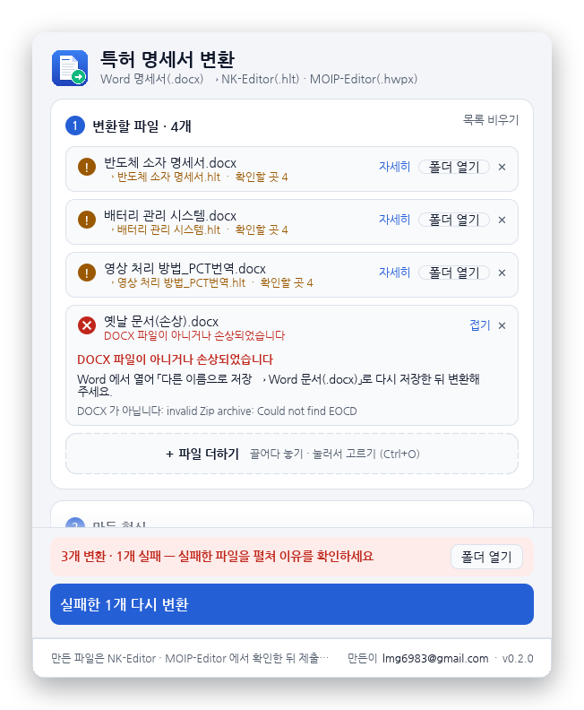
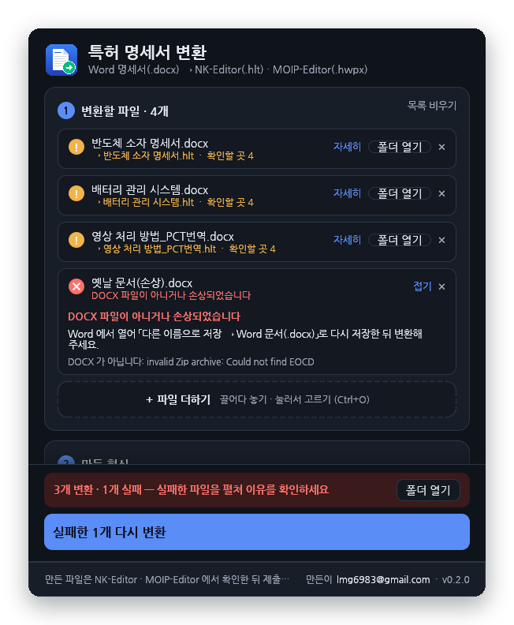
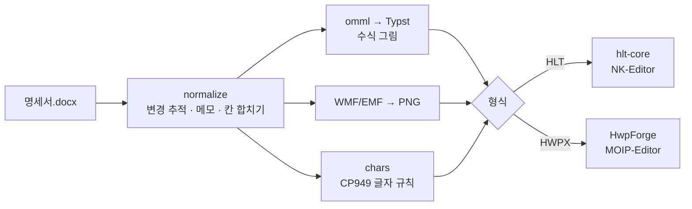

<div align="center">


<br>

**Word로 쓴 특허 명세서(`.docx`)를 NK-Editor(`.hlt`) · MOIP-Editor(`.hwpx`) 파일로 한 번에 바꿉니다.**<br>
수식 · 표 · 그림 · 변경 추적 · 특수 문자까지 — 손으로 다시 옮겨 적던 시간을 없애 줍니다.

<br>

[](https://github.com/lmg6983-dotcom/DOCX_2_HWPX_OR_HLT/releases/latest)
[](https://github.com/lmg6983-dotcom/DOCX_2_HWPX_OR_HLT/releases)
[](https://github.com/lmg6983-dotcom/DOCX_2_HWPX_OR_HLT/actions/workflows/windows.yml)
[](https://www.rust-lang.org)

[**⬇️ 설치 파일 받기**](https://github.com/lmg6983-dotcom/DOCX_2_HWPX_OR_HLT/releases/latest/download/docx2hwpx-hlt-setup-x64.exe) &nbsp;·&nbsp;
[쓰는 법](#-30초-만에-시작하기) &nbsp;·&nbsp;
[자동으로 처리하는 것](#-자동으로-처리하는-것) &nbsp;·&nbsp;
[자주 묻는 질문](#-자주-묻는-질문) &nbsp;·&nbsp;
[CLI](#%EF%B8%8F-cli) &nbsp;·&nbsp;
[English](#-english)

<br>




</div>

<br>

> [!IMPORTANT]
> HLT · HWPX 는 **공개 사양이 없는 형식**입니다. 바꾼 파일은 반드시 **NK-Editor 나 MOIP-Editor 에서 열어 확인한 뒤** 제출하세요.
> 앱이 「편집기에서 확인할 곳」을 따로 짚어 줍니다.

## ✨ 왜 쓰나요?

| 😩 지금까지 | 🚀 DOCX2HWPX-HLT |
|---|---|
| 명세서를 편집기에 문단마다 복사 · 붙여넣기 | 파일을 **끌어다 놓고 버튼 한 번** |
| 수식을 편집기 수식 도구로 다시 입력 | 워드 수식(OMML · 옛 수식 편집기)을 **그대로 그림으로** |
| `x²`, `–`, `ü` 같은 글자가 저장 안 돼서 하나씩 찾아 고침 | CP949 밖 글자를 **자동으로 첨자 서식 · 비슷한 글자 · 글자 그림으로** |
| 변경 추적 · 메모를 지우는 걸 깜빡 | **변경은 모두 반영, 메모는 모두 삭제** 후 변환 |
| 파일 하나씩 | **여러 파일 · 폴더를 한꺼번에** 일괄 변환 |

- 🔒 **완전 오프라인** — 명세서가 컴퓨터 밖으로 나가지 않습니다. 네트워크를 전혀 쓰지 않습니다.
- 🆓 **무료** · 회원 가입 · 인증 없음
- ⚡ **빠름** — Rust 로 만든 단일 실행 파일, 수십 쪽 명세서도 몇 초

## 📦 내려받기

> Windows 10 / 11 (64비트)

| 파일 | 이런 분께 | |
|---|---|---|
| 🧩 **설치 파일** `docx2hwpx-hlt-setup-x64.exe` | **대부분은 이것.** 시작 메뉴 · 탐색기 우클릭 메뉴까지 한 번에 | [**받기**](https://github.com/lmg6983-dotcom/DOCX_2_HWPX_OR_HLT/releases/latest/download/docx2hwpx-hlt-setup-x64.exe) |
| 🗂️ 휴대용 zip `docx2hwpx-hlt-windows-x64.zip` | 설치 없이 USB · 공용 PC 에서 바로 | [받기](https://github.com/lmg6983-dotcom/DOCX_2_HWPX_OR_HLT/releases/latest/download/docx2hwpx-hlt-windows-x64.zip) |
| ⌨️ CLI zip `docx2hwpx-hlt-cli-windows-x64.zip` | 자동화 · 스크립트 · PCT 국내진입 서식 | [받기](https://github.com/lmg6983-dotcom/DOCX_2_HWPX_OR_HLT/releases/latest/download/docx2hwpx-hlt-cli-windows-x64.zip) |

<details>
<summary><b>설치 프로그램이 해 주는 것</b></summary>

<br>

- **관리자 권한 없이** 내 사용자 폴더에 설치됩니다(설치 창에서 「모든 사용자」를 고르면 Program Files).
- 시작 메뉴에 **특허 명세서 변환** 바로가기
- (선택) 바탕화면 바로가기
- 탐색기에서 `.docx` 를 우클릭 → **HLT · HWPX 로 변환** (Windows 11 은 「더 많은 옵션 표시」 안에 있습니다)
- 탐색기 **보내기** 메뉴 — 여러 파일을 골라 한 번에 보낼 때 편합니다
- 제어판 「앱」에서 깔끔하게 제거됩니다(메뉴 · 바로가기 함께 정리)

워드의 `.docx` 기본 연결 프로그램은 **건드리지 않습니다.**

</details>

> [!TIP]
> 처음 실행할 때 Windows 가 「Windows의 PC 보호」 창을 띄우면 **추가 정보 → 실행** 을 누르세요.
> 코드 서명 인증서가 없어서 생기는 안내이며, 이 저장소의 GitHub Actions 가 소스에서 바로 빌드한 파일입니다.

## 🚀 30초 만에 시작하기

```
 ① 파일 놓기          ② 형식 고르기            ③ 변환하기
┌────────────┐     ┌──────┐ ┌───────┐     ┌──────────────┐
│  📄 .docx   │ ──▶ │ HLT  │ │ HWPX  │ ──▶ │  3개 변환하기  │ ──▶  ✅ 같은 폴더에 저장
└────────────┘     └──────┘ └───────┘     └──────────────┘
```

1. **파일 놓기** — `.docx` 를 창에 끌어다 놓습니다. 여러 개 · 폴더째 놓아도 됩니다. (눌러서 고르기 · `Ctrl+O`)
2. **형식 고르기** — **HLT**(NK-Editor · 통합명세서작성기) 또는 **HWPX**(MOIP-Editor)
3. **변환하기** — `Enter` 또는 큰 단추. 끝나면 원본 옆에 `명세서.hlt` · `명세서.hwpx` 가 생깁니다.

파일마다 결과가 표시됩니다.

| 표시 | 뜻 |
|:---:|---|
| 🟢 | 변환 완료 — 바로 제출 전 확인으로 |
| 🟠 | 변환 완료, **편집기에서 확인할 곳**이 있음 — 「자세히」에 목록 |
| 🔴 | 실패 — 이유와 해결 방법을 보여 줍니다 |

> 같은 이름의 파일이 이미 있으면 덮어쓰지 않고 `명세서 (2).hlt` 로 새로 만듭니다. 「덮어쓰기」를 켜면 바꿔 넣으며, 변환이 실패해도 원래 파일은 남습니다.

## 🪄 자동으로 처리하는 것

<table>
<tr>
<td width="50%" valign="top">

### 🧮 수식
워드 수식(OMML)과 옛 수식 편집기(OLE) 개체를 **선명한 그림**으로 넣습니다.
수식은 최소 14pt 로 그려 출력해도 깨지지 않습니다.

### 📝 변경 내용 추적 · 메모
넣기 · 지우기 · 옮기기 · 서식 변경 · 표 줄/칸 변경을 **모두 반영(수락)** 하고,
메모는 본문 표시까지 **모두 지운 뒤** 바꿉니다.

### 🖼️ 표 · 그림
셀을 합친 표, WMF/EMF 도면도 옮깁니다. HLT 에서는 그림을 **300 dpi 상한**으로 다듬어 파일 크기를 줄입니다.

</td>
<td width="50%" valign="top">

### 🔤 HLT 에서 쓸 수 없는 글자
NK-Editor 는 완성형 한글(CP949) 글자만 저장할 수 있어 이렇게 바꿉니다.

| 원래 | 처리 |
|---|---|
| `x²`, `H₂O` | 보통 글자 + **위/아래첨자 서식** |
| `–`, `−` | 모양이 같은 `-` 로 |
| `x̂`, `ü` | **글자 모양 그대로 그림**으로 |
| Symbol 글꼴 기호 | 같은 유니코드 글자로 |

### 📐 HWPX 서식
지식재산처가 정한 명세서 서식(A4 · 바탕체 12pt · 줄 간격 280% 등)에 맞춥니다.

</td>
</tr>
</table>

## ⚠️ 알아 둘 점

- 글상자 안의 글은 옮기지 않습니다.
- 워드 **스타일에만** 정해 둔 서식(글꼴 · 크기 등)은 옮겨지지 않을 수 있습니다. 크기가 없는 글은 12pt 로 처리합니다.
- HLT 는 표 한 칸에 문단을 하나만 넣을 수 있어, 칸 안의 여러 문단은 하나로 합치고 칸 안의 표는 글로 풉니다.
- 화면 앱은 HLT 를 **국내 출원 서식**으로 만듭니다. **PCT 국내진입 서식**은 [CLI](#%EF%B8%8F-cli)의 `--pct` 로 만듭니다.

## ❓ 자주 묻는 질문

<details>
<summary><b>명세서가 외부 서버로 전송되나요?</b></summary>
<br>
아니요. 변환은 전부 내 컴퓨터 안에서 일어나며 프로그램은 네트워크를 전혀 쓰지 않습니다. 인터넷이 끊긴 PC 에서도 동작합니다.
</details>

<details>
<summary><b><code>.doc</code> 파일은 안 되나요?</b></summary>
<br>
<code>.docx</code> 만 읽습니다. Word 에서 열어 <b>다른 이름으로 저장 → Word 문서(*.docx)</b> 로 저장한 뒤 변환하세요.
</details>

<details>
<summary><b>「편집기에서 확인할 곳」은 무엇인가요?</b></summary>
<br>
변환은 됐지만 사람이 눈으로 봐야 하는 곳입니다. 예: 그리지 못해 글로 남은 수식, 글자 그림으로 넣은 특수 문자(편집기에서 글자로 고칠 수 없음), 칸 안에서 글로 풀린 표 등. 파일 줄의 「자세히」를 누르면 목록이 나옵니다.
</details>

<details>
<summary><b>우클릭 메뉴가 Windows 11 에서 안 보여요.</b></summary>
<br>
Windows 11 은 새 메뉴에 등록되지 않은 항목을 <b>「더 많은 옵션 표시」(Shift+F10)</b> 안에 보여 줍니다. 여러 파일은 <b>보내기 → 특허 명세서 변환</b> 을 쓰면 한 창에 모입니다.
</details>

<details>
<summary><b>수식 안 한글 글꼴이 이상해요.</b></summary>
<br>
수식 안의 한글과 글자 그림은 시스템 글꼴을 씁니다. CLI 에서 <code>--font-dir 폴더</code> 로 글꼴을 더 지정할 수 있습니다.
</details>

---

## ⌨️ CLI

```bash
docx2hwpx-hlt 명세서.docx --to hlt                       # → 명세서.hlt (국내 출원 서식)
docx2hwpx-hlt 명세서.docx --to hwpx                      # → 명세서.hwpx
docx2hwpx-hlt 명세서.docx --to hlt --pct -o 번역문.hlt   # PCT 국내진입 서식
```

<details>
<summary><b>폴더 안 모든 파일 한꺼번에 (PowerShell)</b></summary>

```powershell
Get-ChildItem *.docx | ForEach-Object { .\docx2hwpx-hlt.exe $_.FullName --to hlt --overwrite }
```

</details>

| 옵션 | 뜻 |
|---|---|
| `--to hlt\|hwpx` | 만들 형식 |
| `-o 경로` | 출력 경로(기본: 입력과 같은 이름 · 다른 확장자) |
| `--pct` | HLT 를 PCT 국내진입 서식으로 |
| `--overwrite` | 있으면 바꿔 넣기(끝까지 쓴 뒤 바꾸므로 실패해도 원본 유지) |
| `--image-dpi N` | HLT 그림 해상도 상한(기본 300, `0` 이면 다듬지 않음) |
| `--font-dir 폴더` | 수식 · 글자 그림에 쓸 글꼴 폴더 추가 |
| `--json` | 결과를 JSON 한 줄로 — 종료 코드 0 성공 · 1 변환 실패 · 2 잘못된 인자 |

🤖 자동화나 AI 에이전트로 쓸 때의 JSON 계약 · 오류 코드는 [AGENTS.md](AGENTS.md) 에 있습니다.

## 🛠️ 직접 빌드하기

```bash
cargo build --release                                       # CLI → target/release/docx2hwpx-hlt
cargo build --release --features gui --bin docx2hwpx-hlt-gui   # 화면 앱
cargo test
```

<details>
<summary><b>설치 파일 만들기 (Windows · Inno Setup 6)</b></summary>

```powershell
cargo build --release --locked --features gui --bins
iscc /DAppVersion=0.2.0 installer\docx2hwpx-hlt.iss   # → dist\docx2hwpx-hlt-setup-x64.exe
```

`v*` 태그를 올리면 GitHub Actions 가 설치 파일 · 휴대용 zip · CLI zip 을 만들어 릴리스에 붙입니다.

</details>

<details>
<summary><b>구조</b></summary>



| 파일 | 내용 |
|---|---|
| `src/lib.rs` | 변환 핵심 `convert` · `write_atomic` |
| `src/main.rs` | CLI |
| `src/bin/gui.rs` | 화면 앱(egui) |
| `src/normalize.rs` | DOCX 고쳐 쓰기 |
| `src/omml.rs` · `src/render.rs` | 수식 → Typst → PNG |
| `src/chars.rs` | NK-Editor 글자 규칙 |
| `src/hwpx.rs` | HWPX 쓰기 |
| `installer/` | Inno Setup 설치 스크립트 |

</details>

## 🙏 고마운 프로젝트

[seoan-editor `hlt-core`](https://github.com/tornado1014/seoan-editor) (MIT) · [HwpForge](https://crates.io/crates/hwpforge-core) (MIT/Apache-2.0) · [Typst](https://typst.app) · [resvg](https://github.com/linebender/resvg) · [egui](https://github.com/emilk/egui) · [Inno Setup](https://jrsoftware.org/isinfo.php)

---

## 🌐 English

**DOCX2HWPX-HLT** converts Microsoft Word patent specifications (`.docx`) into the two file formats used by the Korean Intellectual Property Office e-filing editors:

| Output | Editor |
|---|---|
| `.hlt` | **NK-Editor** (통합명세서작성기) — domestic & PCT national-phase layouts |
| `.hwpx` | **MOIP-Editor** — the official specification template |

**Highlights**

- Drag & drop **batch conversion** of many files or whole folders, with per-file status and a "things to check" list
- Word equations (OMML and legacy OLE Equation objects) → crisp images; WMF/EMF → PNG
- Tracked changes accepted and comments removed automatically
- For HLT (CP949 only): superscript/subscript look-alikes become real script formatting, look-alike characters are substituted, and anything else is embedded as a glyph image
- 100 % offline, single native binary (Rust), light & dark theme
- Windows installer (no admin rights needed) with Start-menu entry, optional desktop shortcut, `.docx` right-click verb and *Send to* entry

**Download:** grab [`docx2hwpx-hlt-setup-x64.exe`](https://github.com/lmg6983-dotcom/DOCX_2_HWPX_OR_HLT/releases/latest/download/docx2hwpx-hlt-setup-x64.exe) from the latest release. A portable zip and a CLI build (`--json` output for automation, see [AGENTS.md](AGENTS.md)) are attached as well.

> Both formats have no public specification. Always open the result in NK-Editor / MOIP-Editor and check it before filing.
